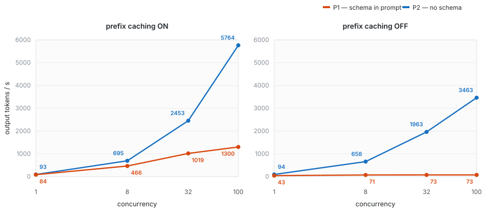

# 将工具schema训进模型：可行性、收益与代价


## TL;DR

本文记录了在单张4090上，使用基于开源驾舱数据集清洗构造的单工具调用数据集中，将**固定的工具候选**通过sft训进较小的参数量级LLM的实验。

| 模型 | 训练时给的输入 | 评测时给的输入 | 准确率（test, n=647） |
|---|---|---|---:|
| Qwen3-4B（不训） | — | 带完整tool schema | 46.52% |
| Qwen3-4B（不训） | — | 不带tool schema | **0.00%** |
| Qwen3-4B + LoRA | 不带tool schema | 不带tool schema | **81.76%** |
| Qwen3-0.6B + LoRA | 不带tool schema | 不带tool schema | 75.73% |
| Qwen3-0.6B + LoRA | **带tool schema** | 带tool schema | **77.59%** |
| Qwen3-0.6B + LoRA | **带tool schema** | 不带tool schema | **0.00%** |

上面是准确率。成本单独放一张表（4B，固定输出 32 token）：

| 成本 | P1（有清单） | P2（训进权重） | 倍率 |
|---|---:|---:|---:|
| 输入 token / 请求 | 5647 | **84** | 67× |
| 首字延迟 · 冷启 | 359.6 ms | **13.3 ms** | 27× |
| 首字延迟 · 前缀缓存 | 23.4 ms | **12.1 ms** | 1.9× |
| 输出吞吐 · 前缀缓存（并发 100） | 1300.5 tok/s | **5764.2 tok/s** | 4.4× |
| KV 占用 | 0.485 GiB | **0.007 GiB** | 67× |
| 训练 1 epoch（0.6B LoRA） | 45–60 min | **70 s** | ~45× |

**一句话**：质量打平，成本在「无缓存 / 高并发」时差距最大，前缀缓存能补回单用户的 TTFT，补不回吞吐和显存。

结论：

1. **工具确实能训进权重。** 不训是 0%，训完 81.76%，比「把tool schema塞进 prompt」的 46.52% 高 35 个点。
2. **SFT后无论tool schema是否在prompt中，效果几乎一致。** 同样是 0.6B，训练时给tool schema、评测时也给tool schema，能拿到 77.59%；训练时不给、评测时也不给，是 75.73%。差 1.9 个点，统计上不显著——**打平**。
3. **迁移是单向的。** 不给tool schema训练，模型能看懂后来给的tool schema（48.22%）；给tool schema训练，把tool schema拿走就彻底归零（0.00%）。而且不是格式坏了——它照样输出工具调用，只是工具名退回「播放歌」这种自己编的词。
4. **真正的收益在成本。** 训进模型后，每个请求少 5563 个 token；冷启动首字延迟 359.6 → 13.3 ms；
   开前缀缓存后单用户几乎打平（1.1 倍），但**100 并发下输出吞吐仍差 4.4 倍**（不开缓存差 47 倍）、
   KV 显存差 67 倍。训练也便宜约 45 倍。

考虑到驾仓场景下（几乎单并发），在驾舱端侧部署一个专门训练的工具调用的决策模型意义不大，无论是从工具调用准确率还是上下文长度引起的ttft、token/s差异，都不具备说服力。只有当场景中并发较大且工具确实极为固定，这样训一下是有意义的，主要收益来自于高并发下的吞吐。

---

## 1. 背景

前阵子听了一个技术分享。分享者做智能驾舱的，讲他们怎么在**端侧**跑一个 4B 模型做工具调用的决策：不把工具定义（schema）塞进 prompt，而是**后训练的时候直接把100多个工具训进权重**。效果足够好，延迟和成本都省了。

这跟现在通用 agent 里主流的 SIP（Schema-in-Prompt）方案是相反的：SIP 是每次请求都把工具清单带在上下文里，模型读着清单调工具。

作为一个对算法涉猎不深的agent工程的同学，直觉上有三个问题：

- 这玩意儿真的能学会？100+ 个工具、每个工具几个参数，模型记得住吗？
- 就算学会了，他的收益是什么？
  - 准确率？难道会比SIP sft后更准？
  - 还是ttft或者token/s上有收益？如果SIP加上前缀缓存呢？

分享里没有这些数字，决定自己做一些实验来探索。

---

## 2. 目标

先把这个问题的名字说清楚。这个设置通常叫 **schema-free tool calling**（也有说 schema-less 的）——
推理时输入里不带任何工具定义。它背后是一个更一般的二分：

- **contextual knowledge**：知识放在上下文里（我们的 P1）
- **parametric knowledge**：知识放在权重里（我们的 P2）

RAG 那一脉早就把这两者分开了。工具调用这边的特殊之处在于：**工具定义是一份结构化的接口契约**，
不是一段自然语言事实。它能不能像事实一样被记住？

拆成四个问题：

1. **可行性**：输入里一个工具定义都没有，只给一句「请用 `<tool_call>` 格式调用工具」，模型能不能正确调用工具？
2. **质量**：和「tool schema 放在 prompt 里」相比，准确率差多少？
3. **归因**：如果它赢了，赢在「训练」还是赢在「清单不在上下文里」？
4. **成本**：推理（token、延迟、吞吐、显存）和训练各便宜多少？开了前缀缓存之后还剩多少？

这里已经默认了一个前提：以上的代价均为限制了工具调用的泛化性，只讨论在固定工具候选集合中性能表现。（也许可以加一个todo,训练之后通用tool call能力掉了多少？但都这么训了说明这个场景没有泛化的需求）

---

## 3. 实验设置

我没有任何私有数据。手头只有一张 4090（24 GB），所以整个实验必须在这个预算内成立。

### 3.1 数据从哪来

用 MAC-SLU——一个公开的中文车载语音理解数据集，一万八千条训练样本，标注是「意图 + 槽位」：

```json
{
  "query": "把副驾座椅按摩切换为肩部舒展",
  "semantics": {
    "意图1": {
      "车载控制": [
        {"name": "intent", "value": "车身控制"},
        {"name": "位置", "value": "副驾"},
        {"name": "对象", "value": "座椅"},
        {"name": "对象功能", "value": "按摩"},
        {"name": "操作", "value": "切换"},
        {"name": "操作_concrete", "value": "为"},
        {"name": "模式", "value": "肩部舒展"},
        {"name": "调节内容", "value": "模式"}
      ]
    }
  },
  "id": "2239"
}
```

它本来是给「意图分类 + 槽位填充」用的，不是给 tool call 用的。所以第一件事是**把标注洗成工具调用**。

### 3.2 原始标注的三个坑

**坑一：意图和工具不是一回事。**
数据里 `intent` 只有二十来种，但「车身控制」下面还有一个 `对象` 字段（座椅、车窗、空调……），
真正的工具是「意图 × 对象」的组合。所以工具名 = `车身控制 + 对象`，其余意图直接当工具。
洗出来 41 个工具。

**坑二：同一个意思有七八种写法。**
`窗户 / 窗 / 车窗`，`车内灯 / 车内灯光 / 阅读灯`，`双闪 / 双闪灯 / 双闪警示灯`。
槽位名也一样：`位置` 和 `车载交互位置` 的取值域包含度是 1.0，必须合并。
我的判据不是「名字像不像」，是**取值域包含度**：`|A∩B| / min(|A|,|B|)`。
名字像但取值不一样的（比如 `功能` 和 `子功能`，包含度 0.47）坚决不合并。

**坑三：多意图、漏标。**
18000 条里 29.5% 压根没有 intent 标注，14.9% 是多意图。
前者不能当负样本——里面大量是漏标（「帮我播一些相声」明明该是 `播放音乐`），
拿去当负样本会教模型「这些 query 不该调工具」。后者这一版直接丢弃。

最后：18000 → 9197（去掉无意图/多意图/缺对象）→ 8219（去掉训练样本 <30 的工具）→ 7993。

> 这里也备注下，清洗后的数据集仍然并非是一个高质量的驾舱 agent tool call 数据集，甚至只是单个工具调用，不包含多个工具调用（也许可以作为todo），但对于我们验证结论至少不会产生负面的影响。

### 3.3 一个样本的清洗全过程

还是上面那条 2239：

| 原始槽位                | 清洗动作          | 结果      |
| ------------------- | ------------- | ------- |
| intent=车身控制 + 对象=座椅 | S1 工具面拆分      | 工具 = 座椅 |
| 位置=副驾               | S5.2 参数契约：cut | —       |
| 对象功能=按摩             | 保留            | 对象功能=按摩 |
| 操作=切换               | 保留            | 操作=切换   |
| 调节内容=模式             | 保留            | 调节内容=模式 |
| 模式=肩部舒展             | S5.2 参数契约：cut | —       |
| 操作_concrete=为       | 噪声槽位，丢弃       | —       |

最终金标：

```json
{"tool": "座椅", "arguments": {"对象功能": "按摩", "操作": "切换", "调节内容": "模式"}}
```

---

## 4. 怎么训

### 4.1 两个范式

同一批样本，两种渲染方式，**唯一的差别是 `tools=` 传不传**：

```python
SYSTEM = "你是车载助手。"
FORMAT_SPEC = (
    "For each function call, return a json object with function name and "
    "arguments within <tool_call></tool_call> XML tags: ..."
)
DIRECTIVE = "你必须调用工具来完成用户的请求，不要用自然语言直接回答。"

def render(paradigm, query, tools):
    system = SYSTEM + "\n\n" + FORMAT_SPEC + "\n\n" + DIRECTIVE
    return tok.apply_chat_template(
        [{"role": "system", "content": system},
         {"role": "user",   "content": query}],
        tools=tools if paradigm == "P1" else None,   # ← 唯一的自变量
        add_generation_prompt=True,
        enable_thinking=False,
    )

# 同一句 query，两种渲染出来的长度：
#   P1 → 5647 token（system 里多了 41 个工具的完整 JSON schema，约 5563 token）
#   P2 →   84 token
```

P1 渲染出来大概长这样（节选）：

```
<|im_start|>system
你是车载助手。

# Tools
You are provided with function signatures within <tools></tools> XML tags:
<tools>
{"type":"function","function":{"name":"播放音乐","description":"...","parameters":{...}}}
{"type":"function","function":{"name":"座椅","description":"...","parameters":{...}}}
... 共 41 个 ...
</tools>

For each function call, return a json object ...
你必须调用工具来完成用户的请求，不要用自然语言直接回答。<|im_end|>
<|im_start|>user
把副驾座椅按摩切换为肩部舒展<|im_end|>
<|im_start|>assistant
<think>

</think>
```

P2 只是把 `<tools>...</tools>` 整块删掉，其余一字不改。

输出格式、金标、解析器、评测脚本完全相同。**这是整个实验能做到干净的唯一原因。**

训练数据只有一份：**P2 渲染的 7993 条**。P1 不参与训练——它只在评测时用来测遗忘。

后来我还加了一个对照臂 `M2′`：用 **P1 渲染**训练（清单在输入里）。没有它，我没法回答第 2 节那个第 3 问。

### 4.2 选型：为什么是 LoRA

先说结论：**4B 全参在 4090 上不可能。**

| 方案 | 显存估算 | 4090 24GB |
|---|---:|---|
| 4B 全参（bf16 + AdamW） | 48–64 GB | ❌ |
| 4B LoRA（bf16 底座） | 12–14 GB | ✅ |
| 0.6B 全参 | 9–10 GB | ✅ |

最后做了三组：

| 臂 | 模型 | 方式 | 可训练参数 | 峰值显存 | 1 epoch |
|---|---|---|---:|---:|---:|
| E1 | Qwen3-0.6B | 全参 | 606 M | 9.2 GB | 70 s |
| E2 | Qwen3-0.6B | LoRA r=16 | 10.1 M（1.7%） | 7.0 GB | 72 s |
| E3 | Qwen3-4B | LoRA r=16 | 33.0 M（0.8%） | 9.3 GB | 360 s |

LoRA 挂在全部线性层（q/k/v/o/gate/up/down），alpha=32，dropout=0.05，lr=1e-4。
全参用 2e-5。3 epoch，batch 8 × accum 4。

**4B 只用 0.8% 的可训练参数就到了 81.76%。** 要记的东西本来就不多——41 个工具名、94 个参数名。

### 4.3 训练的核心逻辑（伪代码）

```python
# 1) 拼样本：prompt 已经以 <|im_start|>assistant\n<think>\n\n</think>\n\n 结尾
prompt_ids = tokenize(record["prompt"])
target = f'<tool_call>\n{json.dumps({"name": tool, "arguments": args}, ensure_ascii=False)}\n</tool_call><|im_end|>'
target_ids = tokenize(target)

input_ids = prompt_ids + target_ids
labels    = [-100] * len(prompt_ids) + target_ids     # 只对 target 算 loss

# 2) P1 的 prompt 有 5673 token，但只有最后 20 来个要算 loss。
#    只对最后 (target_len + 1) 个位置算 logits，否则 24GB 卡直接 OOM。
logits_to_keep = len(target_ids) + 1

# 3) 前向
out = model(input_ids=input_ids,
            labels=labels[:, -logits_to_keep:],
            logits_to_keep=logits_to_keep)
loss = out.loss / grad_accum
loss.backward()
```

为什么 target 里要带 `<|im_end|>`：模型得学会停。
为什么 prompt 已经带 `<think></think>`：Qwen3 是混合推理模型，推理时 `enable_thinking=False`，
训练必须跟推理一致，否则模型会在 `<think>` 里烧 token。

### 4.4 三个工程坑

1. **`merge_and_unload()` 会就地销毁 LoRA 层。**
   第一轮存完盘，第二轮就没有可训练参数了。改成 `merge_adapter()` → 存盘 → `unmerge_adapter()`。

2. **存出来的权重键名是 `X.base_layer.weight`，vLLM 不认。**
   数值其实已经合对了（实测 Δ 与 `B@A×α/r` 的余弦相似度 0.96–0.99，差异是 bf16 舍入），
   写了个 `src/merge_lora.py` 只改键名：`X.base_layer.weight` → `X.weight`。

3. **学习率调度按微批走，而不是按优化器步数。**
   accum=4 的时候 warmup 提前 4 倍结束，余弦退火直接跑出定义域。改成单独计数 `opt_step`。

---

## 5. 结果

### 5.1 主表

test，n=647：

| 模型 | 训练数据 | 评测 P1（有清单） | 评测 P2（无清单） |
|---|---|---|---:|
| Qwen3-4B 不训 | — | 46.52% | 0.00% |
| Qwen3-0.6B 不训 | — | 26.74% | 0.00% |
| 0.6B 全参 | 无清单 | 44.05% | 73.88% |
| **0.6B LoRA** | **无清单** | 48.22% | **75.73%** |
| 4B LoRA | 无清单 | 61.82% | 81.76% |
| **0.6B LoRA** | **有清单** | **77.59%** | 0.00% |

### 5.2 发现一：效果打平

同为 0.6B LoRA：

- 训练无清单、评测无清单：**75.73%**
- 训练有清单、评测有清单：**77.59%**
- 差 1.85 个点，95% 置信区间 ±2.46，McNemar p=0.175
- 换到 dev 上，方向反过来（81.46% vs 79.42%）

结论：无论tool schema是否在prompt中，sft后对工具调用准确率是没有差别的。

### 5.3 发现二：迁移是单向的

| | 评 P1（有清单） | 评 P2（无清单） |
|---|---:|---:|
| 训练 P2（无清单） | 48.22% | **75.73%** |
| 训练 P1（有清单） | **77.59%** | **0.00%** |

- 无清单训练 → 后来给它清单：**48.22%**。它既记得词表，又能读清单，能迁移。
- 有清单训练 → 把清单拿走：**0.00%**。

这是一个蛮有趣的发现，如果sft可以让模型记住特定tool call的调用方式，无论训练时是否带上了tool schema，都应该记住这些工具。
但结果却表明，如果训练时有scheam但是推理时去掉了这些schema，模型一次也没调用成功。

看了下失败的原因，<tool_call>的格式依然是正确的，出错的是工具调用的工具名、参数：工具名退回 `播放歌`、`get_temperature`、`查看天气`，Tool Acc只有 13.3%。这似乎能说明携带tool schema 的sft会让模型学到的是如何照着tool schema中的工具摘抄工具名，而非真的记住了那些工具。

### 5.4 发现三：长尾工具没崩

41 个工具的训练样本极度不均：**5 个头部工具占了 62% 的数据，24 个尾部工具每个不到 60 条**。
如果「把工具训进权重」本质上是记忆，那最可能崩的地方就是尾部——只出现过三五十次的工具，模型可能根本记不住。

所以「长尾崩」的具体定义是：**训练样本 <60 的工具，准确率接近 0，或者远低于头部。**

实测（4B，test）：

| 训练量 | 工具数 | 评测条数 | M1（有清单） | M2（无清单） | 95% CI | 相对保留率 |
|---|---:|---:|---:|---:|---:|---:|
| < 60 | 24 | 79 | 49.37% | **75.95%** | ±9.4 | 1.54× |
| 60–150 | 7 | 76 | 50.00% | **78.95%** | ±9.2 | 1.58× |
| 150–400 | 5 | 110 | 40.00% | **83.64%** | ±6.9 | 2.09× |
| > 400 | 5 | 382 | 47.12% | **82.98%** | ±3.8 | 1.76× |

怎么读这张表：

- **尾部是 75.95%，仍然有显著的提升。** 比预期的要好，我还以为会比较崩，llm只学到少量的高频工具的行为。
- **但它比头部低约 7 个点。** 在 n=79、±9.4 的置信区间内，所以只能说「没有证据表明尾部更差」，
  **不能说「尾部一样好」**。
- **相对基线仍然高 1.5 倍**：即使是最稀有的工具，「训过、无清单」也优于「没训、有清单」。

**不能推出什么**：尾部 75.95% 不代表模型学会了工具接口——它也可能是把 query 和工具名的共现记住了。
要区分这两者，得看没见过的参数值（下面一段），或者做「留出工具」实验（也许是todo）。

另一个证据是 unseen 参数值：seen 87.33%，unseen 70.42%，差 13 个点但绝对值仍然高——
说明它学到的是「参数名 + 生成习惯」，不是「query → 字符串」的查表。

### 5.5 剩下 18% 错在哪

拆开 4B 的 218 条错误（合并 dev+test）：值错 135、工具错 43、漏参 40。
值错里大量是**数据问题**，不是模型问题：

- `降` vs `调低`（近义值漏合并）
- `JANET` vs `janet`（大小写）
- `最大` vs `最大值`
- 金标里偶尔出现 `锅风` 这种 ASR 噪声

两个模型共享 202 条错误（合并 dev+test）——独立假设下只该有约 57 条。

---

## 6. 成本：前缀缓存只能补一半

上面证明了将tool训进模型是可行的，但和sip的方式在sft后没有显著的准确率的差异。那目前唯一的差距在于tool schema占据了大量的上下文，节约掉这些上下文是否可以为ttft、req/s、tok/s带来收益呢？尤其是引入了前缀缓存时，这种差异有多少呢？

**怎么打开前缀缓存**：它是 vLLM 的**引擎构造参数**，不是请求参数——开/关必须重建引擎，
所以我们用两个进程分别跑（这也是为什么下面的数字来自两次独立启动）。

```python
from vllm import LLM, SamplingParams

llm = LLM(
    model="models/Qwen3-4B",
    enable_prefix_caching=True,   # ← 就这一行；关掉就是 False
    max_model_len=10240,
)

sp = SamplingParams(max_tokens=32, temperature=0.0, ignore_eos=True)
outs = llm.generate(prompts, sp)
```

命中条件是**前缀逐字节相同**。我们的 P1 把 41 个工具的 schema 放在 system message 最前面，
每条请求这段完全一致，所以第一条之后全部命中；P2 只有 50 来个 token 的格式说明，也命中，但省得很少。

起 OpenAI 兼容服务时对应 `vllm serve ... --enable-prefix-caching`。
验证方法很简单：同一批 prompt 连跑两次，第二次的耗时应该明显下降（我们的 P1 首字延迟 359.6 → 23.4 ms）。

### 6.1 首字延迟

4B，单卡 4090，`max_tokens=1`：

| 场景 | P1（有清单） | P2（无清单） | 倍率 |
|---|---:|---:|---:|
| 首字延迟 · 冷启 | **359.6 ms** | **13.3 ms** | **27×** |
| 首字延迟 · 前缀缓存 | **23.4 ms** | **12.1 ms** | **1.9×** |

结论：没有前缀缓存时，差异显著。但有前缀缓存时，差异几乎可忽略。

### 6.2 固定输出 32 token 的吞吐

| 并发 | 指标 | P1 | P2 | 倍率 |
|---:|---|---:|---:|---:|
| 1 | 单请求延迟 · 冷启 | 735.7 ms | 338.9 ms | 2.17× |
| 1 | 单请求延迟 · 缓存 | 379.7 ms | 343.7 ms | **1.10×** |
| 100 | 输出 tok/s · 冷启 | **73.4** | **3463.4** | **47×** |
| 100 | 输出 tok/s · 缓存 | **1300.5** | **5764.2** | **4.4×** |
| 100 | req/s · 缓存 | 40.6 | 180.1 | 4.4× |

**并发曲线**（输出 tok/s，左：开缓存；右：不开缓存）：



左图两条线都在涨，差距是 4.4 倍；右图 P1 从并发 8 开始就平了——它已经卡在 prefill 算力上，
再加并发只是排队。

### 6.3 分析

**前缀缓存省的是 prefill，不省 decode。**

每生成一个 token，注意力都要把 5647 个 token 的 KV 从显存里读一遍。这笔带宽开销不受缓存影响。

- **并发 1**：这点开销被固定成本摊薄，P1 只比 P2 慢 1.10×。
- **并发 100**：decode 成了主要工作，差距放大到 4.4×。固定 32 token 时，P1 每 token 多花约 **1.1 ms**。
- **不开缓存**：P1 直接饱和——并发从 8 加到 100，输出 tok/s 一直停在 73 左右，加并发没用。

**显存**：4B 的 KV 是 90 KB/token。一份 schema = **0.485 GiB**，P2 的 84 token = 0.007 GiB。
相同 schema 的请求能共享一份，但每套**不同**的工具集都要一份。

因此，我们并不能说有了前缀缓存后，sip和训进模型没有任何差别
- prefill 可以缓存 → 单用户首字延迟接近免费（仍差 1.9×）
- decode 的注意力与 KV 占用不能缓存 → 高并发输出吞吐差 4.4×、每套 schema 多占 0.485 GiB
- 不开缓存 → 吞吐差 47×，而且会饱和

---

## 7. 这些结果说明什么

对那场分享里的做法，我的判断是：**方向成立，但「效果足够好」要拆开看。**

- ✅ **能训进去**：0% → 81.76%，而且只用了 0.8% 的可训练参数。
- ✅ **不掉质量**：和「清单在 prompt 里」训练打平（差 1.9 个点，不显著）。
- ✅ **成本真的省**：token 67×、冷启延迟 27×、开缓存后高并发输出吞吐 4.4×、KV 67×、训练 45×。
- ⚠️ **成立条件很窄**：训练输入里不能有清单。有清单就只学到照抄。
- ⚠️ **不是「更准」**：如果你的工具集很小、请求量很低、前缀缓存命中率很高，那这套的收益会大幅缩水。

如果我要在端侧做一个工具调用模型，我会这么选：

| 场景 | 建议 |
|---|---|
| 工具集固定、请求量大、显存紧张 | 训进权重，收益最大（吞吐 + KV） |
| 工具集经常变（插件、MCP） | 别训。每次重训的成本比省下的高 |
| 低 QPS、冷启动多、显存极度珍贵 | 训进权重，首字延迟差距最明显 |
| 需要模型解释「为什么调这个工具」 | 清单在上下文里更好，可读可审计 |

---

## 8. 限制

由于能力有限、资源有限、时间有限，避免给大家带来误导在此澄清一些可能的限制
- 只在较小的模型上测试过
- 只有 41 个工具
- 只有单轮工具调用
- 单 seed，没重复实验
- 没有回归通用tool call能力
- 延迟是离线单卡测的。倍率可参考，绝对值不能外推到生产环境。
- 数据是自己洗过的，没有投入足够的时间检查。那些近义值、大小写的残余错误，是数据问题，会同时压低两个范式。
